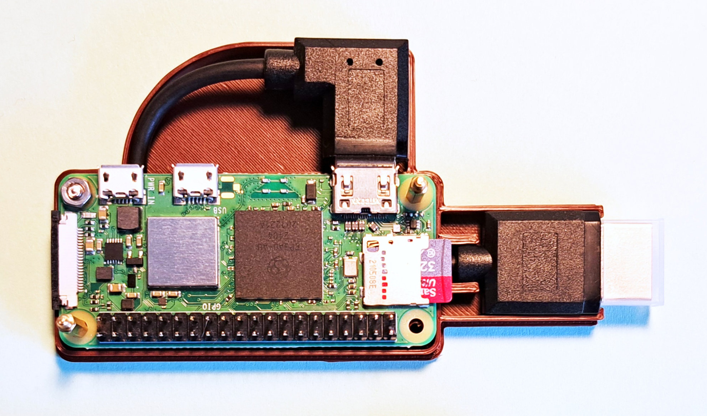

Case for a Pi0-(2)-W based Mediastick
=====================================

This repo holds the  OpenSCAD design files for a
Pi-Zero W/2W based mediastick:

Hardware
--------

Required hardware:

  - a Pi-Zero W/2W
  - a short, angled Mini-HDMI to HDMI cable
    (https://www.amazon.de/dp/B08Q3K28ZK)

The target use-case of the stick is to plug it into a TV and to also
power it directly from an USB-socket on the TV. 

Installation
------------

This repository uses submodules, so you either need to clone with

    git clone --recurse-submodules https://github.com/bablokb/3D-pi0w-media-stick

or update the submodules after a normal clone:

    git clone https://github.com/bablokb/3D-pi0w-media-stick
    git submodule update --init --recursive

You also need the BOSL2-library from <https://github.com/BelfrySCAD/BOSL2>.

License
-------

[![CC BY-SA 4.0][cc-by-sa-shield]][cc-by-sa]

This work is licensed under a
[Creative Commons Attribution-ShareAlike 4.0 International
License][cc-by-sa].

[![CC BY-SA 4.0][cc-by-sa-image]][cc-by-sa]

[cc-by-sa]: http://creativecommons.org/licenses/by-sa/4.0/
[cc-by-sa-image]: https://licensebuttons.net/l/by-sa/4.0/88x31.png
[cc-by-sa-shield]:
https://img.shields.io/badge/License-CC%20BY--SA%204.0-lightgrey.svg
